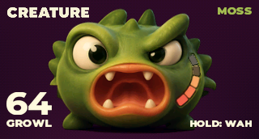

# Creature 0.5.3

画面中的生物跟着 Wah 踏板动作张嘴，并可调 Growl。

先安装下表的配套算法包，再安装 App。

| 文件 | 版本 |
| --- | --- |
| [App.rpk](App.rpk) | Creature 0.5.3 |
| [Audio-Pack.rpk](Audio-Pack.rpk) | Creature Voice 0.2.4 |

[套件说明](套件说明.md) · [App 源码](source/) · [配套算法源码](source/dsp/) · [版本和校验值](manifest.json) · [社区发布文案](社区发布文案.md)
