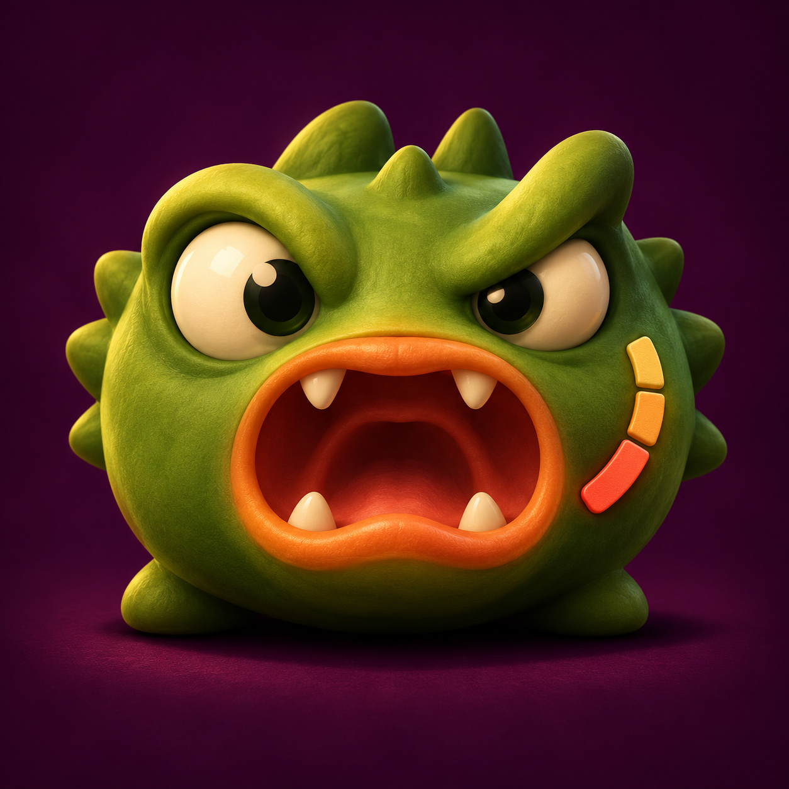

# Creature

按住下方旋钮，Wah 往前推，屏幕里的生物也跟着张嘴。松手后，两边一起回落。

## 配套音频包

先安装音频包，再安装 App。

- Creature Voice `org.resona.demo.creature.voice` 0.2.4

## 两个编码器

| 页面／模式 | 上方旋转 | 上方短按 | 上方长按 | 下方旋转 | 下方短按 | 下方长按／按住 |
| --- | --- | --- | --- | --- | --- | --- |
| Creature | 选 MOSS／VELVET／CINDER／REED 四种哇音 | 干声对比开／关 | 立即保存 | 调 GROWL 0～100 | 短踩一次哇音动作 | 按住推到前端哇位，松开回落 |

## 项目详细说明

# Creature

A painted creature that is a wah pedal. Hold the big knob and a Vox-style wah rocks from heel to toe while the
creature's mouth opens with it; turn it for growl. The sound is the nested `dsp/` pack (**Creature Voice**); the App
builds its own Guitar -> Creature Voice -> Output graph and drives it.

The pack must be installed in the Box's library first. Until it is, the App shows **INSTALL CREATURE VOICE IN LAB**
and retries once a second.

## Controls

| Control | Turn | Click | Long press / hold |
|---|---|---|---|
| SELECTOR (top) | wah voicing: MOSS, VELVET, CINDER, REED | DRY: compare with the dry guitar at the same loudness | save now |
| CUSTOMIZE (big) | GROWL 0 to 100 (2 per detent) | Short Wah stroke | hold: the wah rocks to the toe in 0.3 s and stays; release rocks back in 0.4 s |

Taps on the big knob in rhythm play wah-wah strokes. At rest, each voicing keeps its own fixed filter tone. Guitar picking
bounces the creature's jaw.

Voicing, growl, DRY, MIX and LEVEL are saved, 1.8 s after the last edit (or at once with a top long press).

If the OS bypasses the voice for its CPU budget, the App shows **CPU LIMIT**, drops its effect graph and rebuilds it
after 2 s, then 10 s, then 30 s while trips keep coming.

## The screen

The creature is the painting in `assets/creature-reference.png`, cut into layers and animated as a 2D puppet:
breathing, blinks, squints, glances, head tilt and lift. Its mouth is the pedal, a round "oo" at the heel and a wide
"aa" at the toe, with the head lifting and the eyes squeezing as it opens.

- **Top right**: the voicing, or DRY while comparing.
- **Bottom left**: GROWL and the painted meter, dimmed above the current level.
- **Bottom right**: the caption, HOLD: WAH, then WAH, WAAH, WAAAH as the pedal opens.

The App also writes a boot splash (`src/splash_data.h`) when it differs: two eyes open in the dark, blink, and the
creature roars with the wah wide open. It plays from the next power-up.

## Controller

Web (`controller/web/`), Mobile (`controller/mobile/`) and any MIDI controller play Creature: one CC per control on
channel 1, and CC 119 asks the App for every value. Page PLAY has the three hold pads and a Growl × Mix pad; page
VOICE has every setting. The pads override the settings only while held.

| CC | Control | Values |
| --- | --- | --- |
| 20 | Growl | 0–127 = 0–100 % |
| 21 | Wah voicing | 0 MOSS, 1 VELVET, 2 CINDER, 3 REED |
| 22 | Dry compare | 0 off, 1 on |
| 23 | Mix | 0–127 = 0–100 % (default 100) |
| 24 | Level | 0–127 = 0–100 % of the wet (default 82, unity) |
| 30 | WAH pad | 127 rocks the pedal to the toe, 0 rocks it back |
| 31 | ROAR pad | 127: the pedal to the toe with growl 100; 0 releases |
| 32 | DRY pad | 127: the guitar alone (mix 0); 0 releases |
| 116 / 117 | Input / output meter | sent by the App to a port that sent CC 119 |
| 119 | Query | any value: the App answers with every value |

Settings record version 3 adds MIX and LEVEL; version 1 and 2 records still load (MIX 100, LEVEL 82).

### Bench control (bench builds only)

Only in a build with `-DRESONA_DEMO_BENCH` (also the frame capture and the stats SysEx); a normal build ignores
these. Channel 16 MIDI CCs use the same handlers as the knobs:

| CC | Value | Action |
| --- | --- | --- |
| 20 | 64 + signed detents | Top turn |
| 21 | 64 + signed detents | Big turn |
| 22 / 23 | 127 down, 0 up | Top / big raw key |
| 24 / 25 | Any nonzero | Top / big short click |
| 26 / 27 | Any nonzero | Top / big long press |

A long press without a matching raw held key lasts one second.

## DSP: Creature Voice

    input -> wah -> GROWL -> wet LEVEL -> DC blocker and soft limiter
    dry input + processed wet -> MIX -> output

The wah is the Cry Baby model by Julius O. Smith (CCRMA, Faust `crybaby`): a two-pole resonator whose frequency, Q
and gain move with the pedal. Its gain follows a table measured on a guitar DI, so every voicing stays close to the
dry level through a stroke.

| Voicing | Sweep | Q heel to toe | Character |
|---|---|---|---|
| MOSS | 430 Hz to 1.8 kHz | 6 to 2.2 | Vox V847-style: lower top, softer peak |
| VELVET | 350 Hz to 1.5 kHz | 4 to 1.8 | smooth and dark |
| CINDER | 450 Hz to 2.2 kHz | 8 to 2 | Smith's measured Cry Baby fit |
| REED | 500 Hz to 2.4 kHz | 11 to 4 | narrow and vocal |

| Parameter | Range | Set by the App |
|---|---|---|
| GROWL | 0 to 100 % | big turn (64 at start); 100 while ROAR is held |
| CHARACTER | 0 MOSS, 1 VELVET, 2 CINDER, 3 REED | top turn; changes morph over about 0.1 s |
| WAH | 0 to 1 | big hold, or the WAH / ROAR pad |
| MIX | 0 to 100 % (0: the guitar at unity) | 100, or the controller; 0 while DRY |
| LEVEL | 0 to 100 % of the wet (82 is unity) | 82, or the controller |

## Build

    resona-lab check dsp
    resona-lab pack build dsp
    resona-lab pack install dsp/build/*.rpk     # the Box's library: no preset slot is written
    resona-lab app build .
    resona-lab app install .
    python3 tools/encode_rig.py                 # regenerate src/rig_art.h from the painting (numpy, scipy, Pillow)
    python3 tools/make_splash.py                # regenerate src/splash_data.h (host clang++, numpy, scipy)

The corner type is Montserrat Bold (SIL OFL, `assets/Montserrat-OFL.txt`); a normal build needs only the generated
headers.

MIT, see LICENSE.

DRY 现在直接对比未经滤波与限幅的吉他输入。

Wah 系数每 16 个采样更新一次，采样计数跨音频处理块连续。

松手直接弹也有四种音色。MOSS 圆润，VELVET 偏暗，CINDER 明亮，REED 带人声感。按住下方仍能扫 Wah，短按上方切换 DRY。

## 0.5.4

The original Creature artwork fades in after the eye blink. The mouth follows the Wah with less overshoot.
